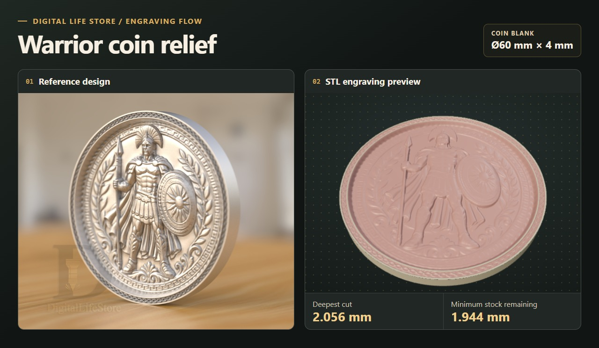
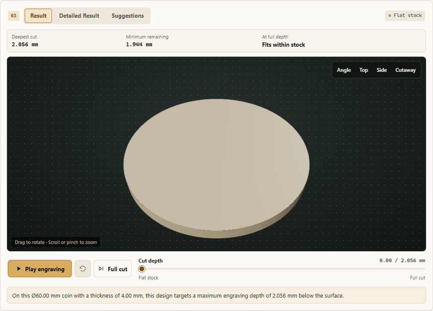
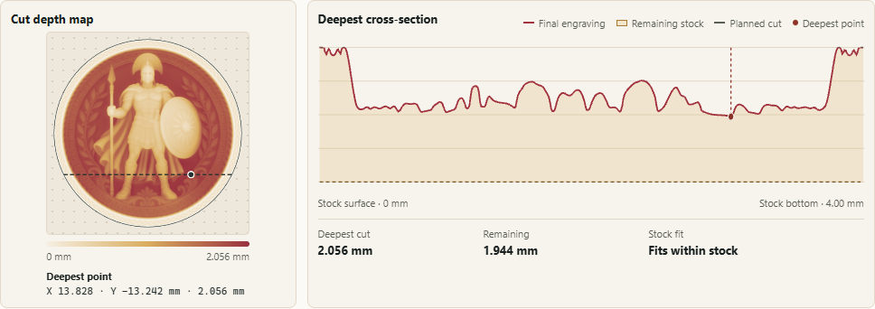
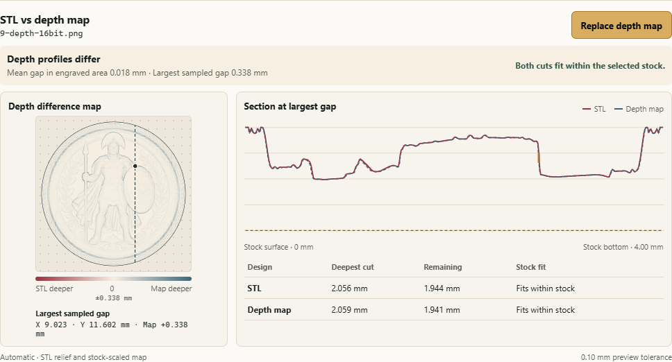

# Digital Life Store Engraving Flow

Engraving Flow by Digital Life Store shows the depth a design targets on the blank you plan to use. Load an STL relief or a grayscale depth map. Enter the coin diameter or the flat blank's width and length, then set the material thickness. The 3D preview shows the deepest planned cut in millimeters below the surface and how much stock would remain beneath it.

## Warrior coin example

This example shows an STL and its companion 16-bit PNG depth map on a **60 mm diameter, 4 mm thick coin blank**. Both previews use **Automatic** mode.

### 1. Follow the cut in 3D

In **Result**, drag the depth slider from the untouched blank to the full cut. Use the angle, top, side, and cutaway views to inspect the relief.

Watch the engraving preview

### 2. Find the deepest point

**Detailed Result** marks the deepest point on the top-down cut map. The red line in the cross-section shows the planned profile at full depth. The dashed gold line marks the bottom of the blank.

### 3. Compare the STL and depth map

Load the STL's companion depth map to compare both designs on the same blank. Both cuts fit within the selected stock.

| Design | Deepest target cut | Minimum stock remaining |
| --- | ---: | ---: |
| STL | 2.056 mm | 1.944 mm |
| 16-bit depth map | 2.059 mm | 1.941 mm |

The mean gap across the engraved area is **0.018 mm**. At the point marked below, the planned cut from the depth map is **0.338 mm** deeper than the STL cut. That exceeds the **0.10 mm** preview tolerance, even though the deepest cuts are close.

## How the preview sets depth

The diameter or the width and length set the design's footprint. Engraving Flow preserves the design's proportions and finds the deepest point within the blank's outline.

- In **Automatic** mode, an STL keeps the vertical scale of its relief. Engraving Flow treats its model units as millimeters.
- In **Automatic** mode, a PNG or PGM depth map uses the stock thickness as its depth scale. White maps to the surface and black to the stock bottom.
- In **Manual** mode, enter a maximum cut depth in millimeters for either input. The rest of the profile scales proportionally.

The preview flags a cut that reaches or goes through the blank. Files are processed locally in your browser.

## Plan a laser test

On a suitable laser setup, higher power or more passes can deepen a physical engraving. The depth and finish also depend on the material, laser, lens and focus, and settings such as scan speed, pulse frequency, and line spacing. [Laserax's guide to engraving aluminum](https://www.laserax.com/blog/laser-engraving-aluminum) · [LightBurn's 3D Sliced guide](https://docs.lightburnsoftware.com/latest/Guides/3DSlicedImage/)

**Suggestions** lists published starting settings. With compatible test cuts that bracket your target depth, it can estimate a pass or layer count for the same design, placement, material, and machine setup. Measure a confirmation cut on the same material before engraving the final blank. [LightBurn's Material Test guide](https://docs.lightburnsoftware.com/latest/Reference/MaterialTest/)

[Digital Life Store](https://digitallifestore.net/)
